<div align="center">

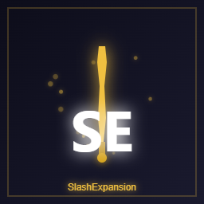

# SlashExpansion

**为「拔刀剑：重锋」追加 12 种 SA 与 12 种 SE**

[](https://www.minecraft.net/)
[](https://files.minecraftforge.net/)
[](https://www.curseforge.com/minecraft/mc-mods/slashblade-resharped)
[](LICENSE)

[**中文**](README.md) | [English](README_EN.md)

</div>

---

## 这是什么

> 本页对应 **Minecraft 1.20.1 / Forge**。1.21.1 / NeoForge 版本是独立构建（NeoForge 分支），玩法内容一致。

**SlashExpansion** 是 [拔刀剑：重锋 (SlashBlade: Resharped)](https://www.curseforge.com/minecraft/mc-mods/slashblade-resharped) 的附属模组，为游戏追加 **12 种全新的 SA（特殊攻击）** 与 **12 种强大的 SE（特殊效果）**。

- **不新增刀剑**，只扩展拔刀剑的技能与词条体系。
- 所有 SA 的伤害都基于你**当前持有的刀**动态计算，随装备一起成长，不会出现「前期秒杀、后期刮痧」。
- 每个 SA 都配有**分阶段的时间轴动画**（蓄势 → 斩击 → 冲击 → 余韵），不是瞬间炸开一堆粒子。
- 数值、SA 的宝箱获取、SE 的合成配方**全部可在配置文件里改**，整合包可以自由定制。

---

## 效果展示

> 以下画面取自游戏内实机录制，未做调色。

### 动态演示

<table>
  <tr>
    <td align="center">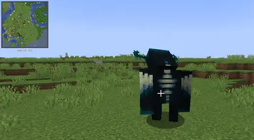<br><sub>万剑归宗</sub></td>
    <td align="center">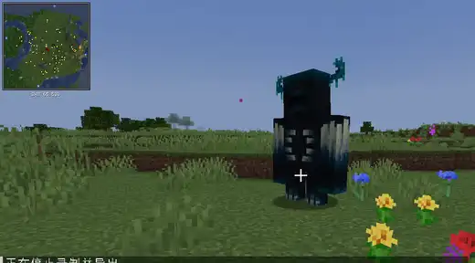<br><sub>千本樱</sub></td>
  </tr>
  <tr>
    <td align="center">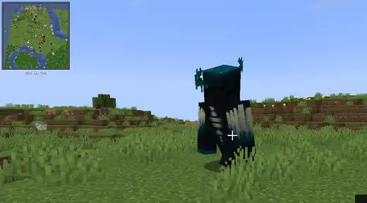<br><sub>七杀剑界</sub></td>
    <td align="center">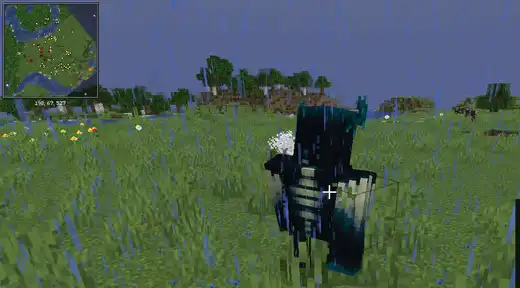<br><sub>血月斩</sub></td>
  </tr>
  <tr>
    <td align="center">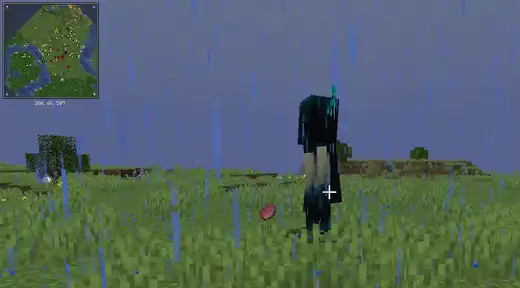<br><sub>雷神之怒</sub></td>
    <td align="center">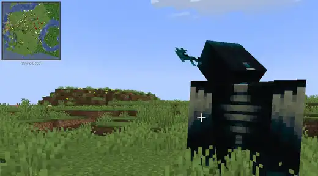<br><sub>不动明王</sub></td>
  </tr>
</table>

### 静态截图

<table>
  <tr>
    <td align="center">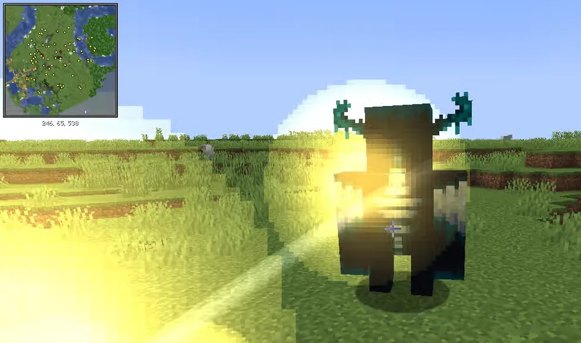<br><sub>万剑归宗</sub></td>
    <td align="center">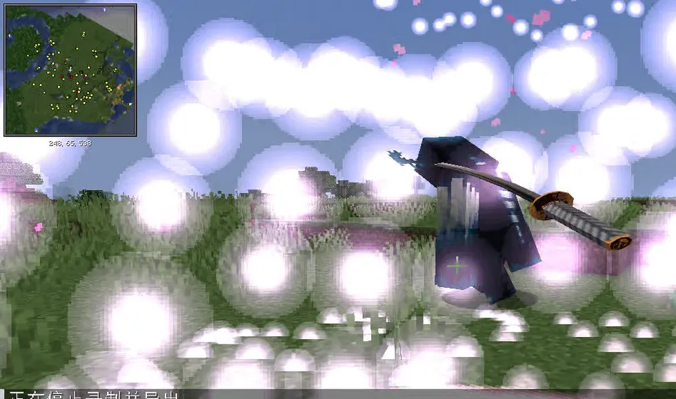<br><sub>千本樱</sub></td>
  </tr>
  <tr>
    <td align="center">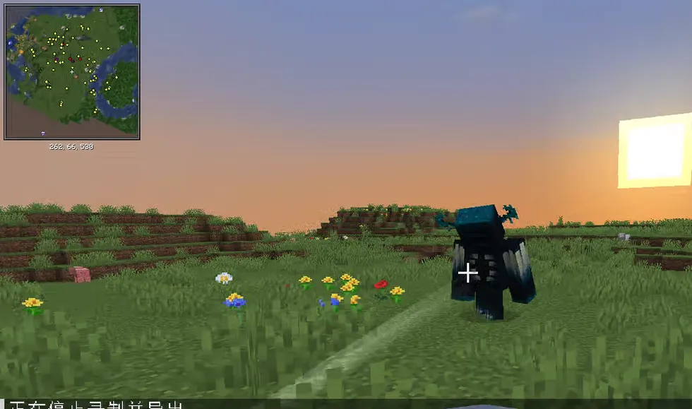<br><sub>裂空斩</sub></td>
    <td align="center">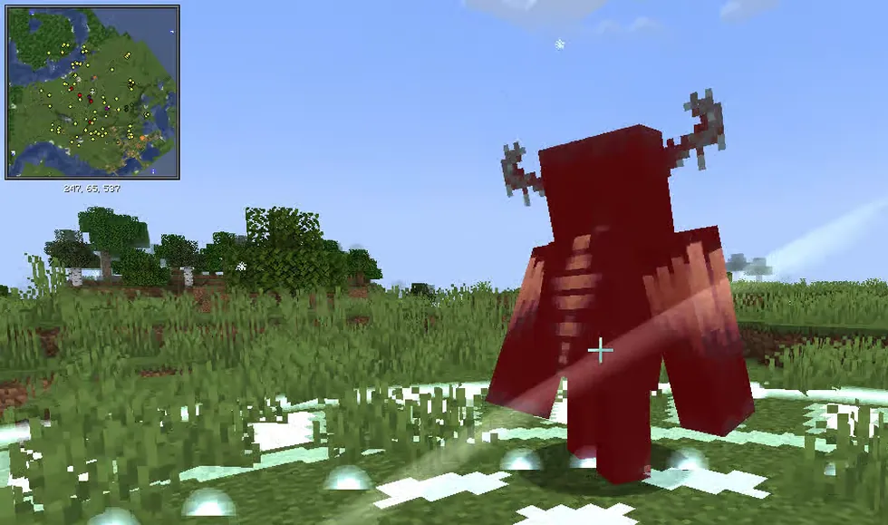<br><sub>冰霜领域</sub></td>
  </tr>
  <tr>
    <td align="center">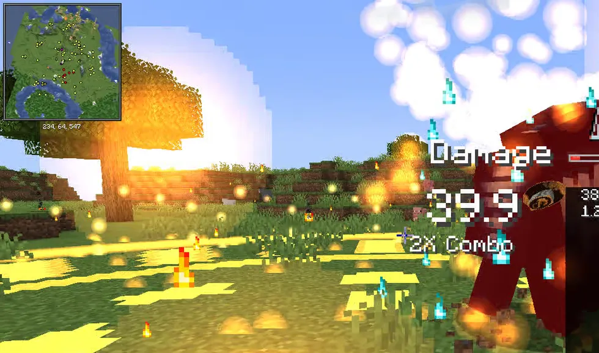<br><sub>业火焚城</sub></td>
    <td align="center">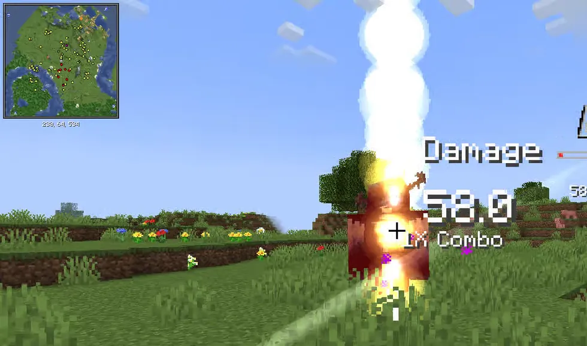<br><sub>斩天拔剑术</sub></td>
  </tr>
  <tr>
    <td align="center">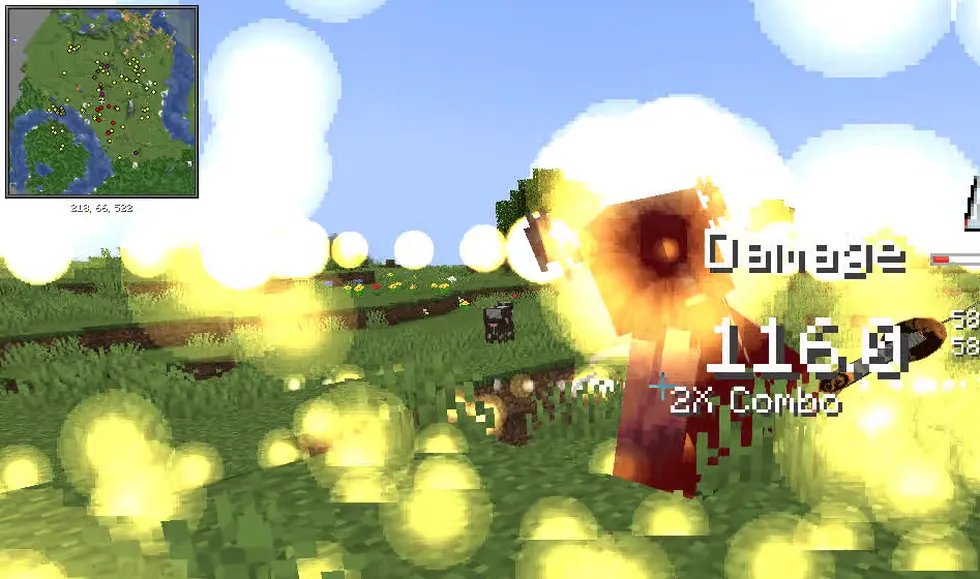<br><sub>剑荡八荒</sub></td>
    <td align="center">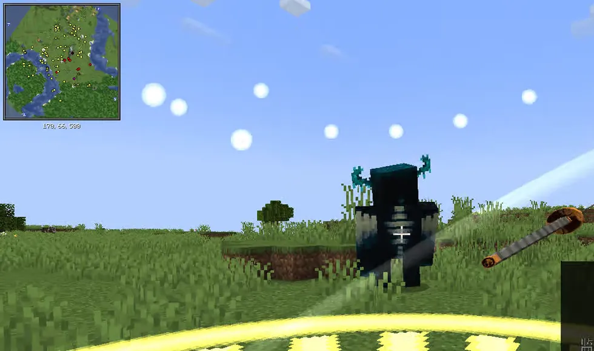<br><sub>庚金剑诀</sub></td>
  </tr>
  <tr>
    <td align="center">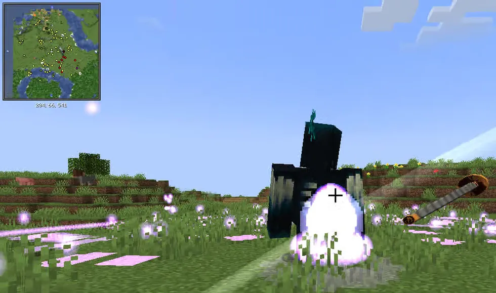<br><sub>七杀剑界</sub></td>
    <td align="center">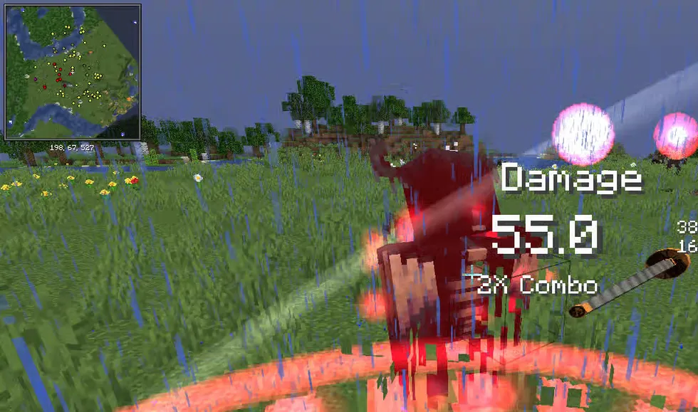<br><sub>血月斩</sub></td>
  </tr>
  <tr>
    <td align="center">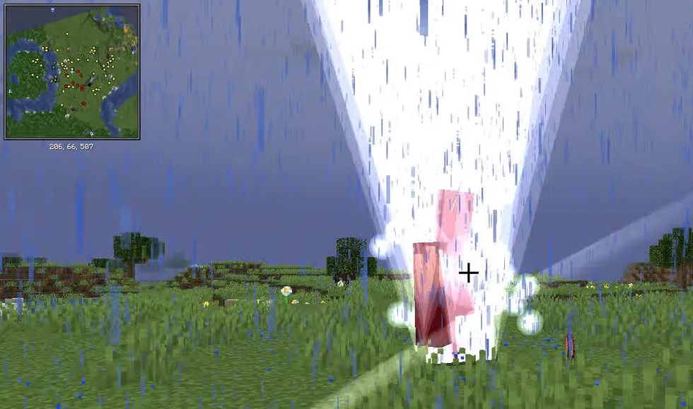<br><sub>雷神之怒</sub></td>
    <td align="center">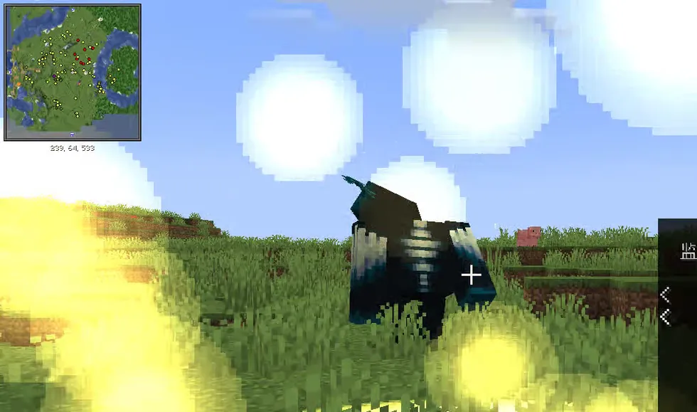<br><sub>不动明王</sub></td>
  </tr>
</table>

---

## 下载

- **GitHub Releases**：<https://github.com/lisheng233/SlashExpansion/releases>

> 下载时请认准与你的游戏版本对应的 jar（文件名里带 `1.20.1` 或 `1.21.1`）。

---

## 安装
| 依赖 | 版本 |
| :--- | :--- |
| Minecraft | **1.20.1** |
| Forge | **47.x**（开发环境 47.4.16） |
| [拔刀剑：重锋](https://www.curseforge.com/minecraft/mc-mods/slashblade-resharped) | **1.5.0 或更高** |

1. 安装对应版本的 Forge。
2. 把 **拔刀剑：重锋** 和本模组的 jar 一起放进 `mods/` 文件夹。
3. 启动游戏。模组同时兼容**单人**与**专用服务器**（客户端、服务端都要装）。

> 首次启动后会生成配置文件 `config/slashexpansion-common.toml`。

---

## 12 种 SA（特殊攻击）

| SA | 效果 | 伤害系数 | 宝箱获取 |
| :--- | :--- | :--- | :--- |
| **万剑归宗** | 召唤 10~256 把幻影剑从天而降，剑数随经验等级增加 | 80% | 远古城市 10%、下界要塞 8% |
| **千本樱** | 樱花剑阵环绕，每个目标 4~6 把剑，穿透并带樱花特效 | 120% | 远古城市 20% |
| **裂空斩** | 冲刺突进 + 8 方向剑气 | 180% | 末地船 / 末地城 25% |
| **冰霜领域** | 20 格范围冻结，迟缓 X、虚弱 II、挖掘疲劳 IV | 80% | 远古城市 15% |
| **业火焚城** | 地面火焰爆发 + 12 秒灼烧，对下界生物额外 +50% | 100% + 灼烧 | 堡垒遗迹（宝藏）15% |
| **斩天拔剑术** | 竖直巨型剑气，飞行 64 格，无视阻挡 | 150% | 远古城市 10%、末地城 12% |
| **剑荡八荒** | 横向巨型剑气，飞行 64 格，无视阻挡 | 150% | 远古城市 10%、末地城 12% |
| **庚金剑诀** | 1~100 把金色幻影剑，数量与锻造数相关，无视护甲 | 160% | 远古城市 8%、堡垒遗迹 10% |
| **七杀剑界** | 领域内连续 7 次伤害，7 种伤害类型循环，范围随杀敌数提升 | 100% × 7 | 远古城市 5%、下界要塞 6% |
| **血月斩** | 消耗自身 30% 当前生命，对前方 8 格造成「基础伤害 + 消耗生命兑换的伤害」 | 基础 + 兑换 | 下界要塞 10% |
| **雷神之怒** | 对 20 格内随机敌人降下 7 道闪电，每道 120% 伤害并麻痹 3 秒 | 120% × 7 | 堡垒遗迹 12% |
| **不动明王** | 3 秒内免疫所有伤害但无法移动，结束后对 10 格范围造成 200% 伤害并击退 | 200% | 堡垒遗迹 8% |

**伤害是怎么算的**

```
基础伤害 = max(10.0, 刀面板 + 锻造数 × 0.5 + 力量附魔等级 × 2.0 + 玩家基础攻击)
最终伤害 = 基础伤害 × 该 SA 的伤害系数
```

- 伤害下限、锻造加成、力量加成与每个 SA 的系数都能在配置里调。
- **裂空斩**的每把剑气都按 180% 独立结算，8 把全中时总伤害为 `8 × 180%`，需要削强度就调 `[sa.rift_slash]` 的 `damageMultiplier` 或 `bladeCount`。
- **雷神之怒**的闪电默认只做视觉表现（`[sa.thors_wrath] visualOnly = true`），不会产生原版雷击伤害与火焰。

---

## 12 种 SE（特殊效果）

| SE | 效果 |
| :--- | :--- |
| **风神的伟力** | 跳跃提升 III、免疫摔落伤害、移速 +100%、飞行速度 +150%（仅主手生效） |
| **寒霜的辉光** | 免疫霜冻伤害，攻击附加霜冻伤害 |
| **超越的意志** | 附魔等级 +5，伤害 ×1.5，暴击率 +25% |
| **深渊的低语** | 等级 ≤99：自身反胃 I、饥饿 I、霉运 V、凋零 II，攻击附加凋零 X、失明 I、虚弱 V、缓慢 V、挖掘疲劳 III；等级 ≥100：自身霉运 III、凋零 I |
| **虚空之力** | 攻击附加虚空伤害并给目标负面效果；持刀时免疫虚空伤害与负面效果 |
| **管理员之力** | **需要权限等级 4**：持刀时免疫伤害、负面效果与击退，可飞行、持续回满状态并清除负面效果；近战直接秒杀目标（默认 3 格溅射）。伤害、移除、踢出在底层被拦截 |
| **烈焰之心** | 攻击点燃敌人 5 秒；免疫火焰伤害；下界移速 +20% |
| **虚空行者** | 站在方块边缘自动悬浮；末地移速 +30%；对末影人伤害 ×2 |
| **千锤百炼** | 耐久消耗减半；击杀回复 1 点耐久；每 10 点杀敌消耗 100 耀魂，锻造上限 +1（最多 100 次） |
| **死神之约** | 生命低于 30% 时攻击力 +50%，代价是每秒流失 1 点生命（不会致死） |
| **精灵祝福** | 白天移速 +20%，夜晚攻击力 +30%；免疫中毒；箭矢伤害 +50% |
| **龙魂共鸣** | 击杀末影龙后永久 +10% 攻击力；攻击时 5% 概率触发龙息范围伤害 |

---

## 获取与使用

### SA：开结构宝箱

在下列结构宝箱中有概率开出**带对应 SA 的耀魂宝珠**：

| 结构 | 可获得 SA | 概率 |
| :--- | :--- | :--- |
| 远古城市 | 万剑归宗 / 千本樱 / 冰霜领域 / 斩天拔剑术 / 剑荡八荒 / 庚金剑诀 / 七杀剑界 | 10% / 20% / 15% / 10% / 10% / 8% / 5% |
| 末地船 · 末地城 | 裂空斩 / 斩天拔剑术 / 剑荡八荒 | 25% / 12% / 12% |
| 堡垒遗迹（宝藏） | 业火焚城 / 庚金剑诀 / 雷神之怒 / 不动明王 | 15% / 10% / 12% / 8% |
| 下界要塞 | 万剑归宗 / 七杀剑界 / 血月斩 | 8% / 6% / 10% |

### SE：合成

12 种 SE 全部通过合成获得，配方可在 JEI / 配方书里查到，也可在配置中自由修改。

> **龙魂共鸣** 的合成格只有 9 格，所以材料是：龙蛋 ×1 + 龙息 ×7 + 耀魂结晶 ×1。

### 装到刀上

1. 拿到带 SA 的**耀魂宝珠**，或带 SE 的**耀魂结晶**。
2. 把宝珠 / 结晶和任意拔刀剑一起放到**刀挂台**上。
3. 左键点击，SA / SE 就会转移到刀上。
4. SA 需要**右键蓄力**释放；SE 是**被动**效果，持刀即生效。

---

## 配置

所有可调项集中在 **`config/slashexpansion-common.toml`**（首次启动自动生成）。

- 数值类配置：改完重启游戏生效。
- `[loot]` 与 `[recipe]`：重启服务器或执行 `/reload` 生效。
- `[vfx]`：**热读取**，改完回到游戏立即生效。

| 分组 | 内容 |
| :--- | :--- |
| `[damage]` | 基础伤害公式：伤害下限、锻造加成、力量附魔加成 |
| `[sa.<技能>]` | 每个 SA 的伤害系数、索敌半径、剑数、生效半径、持续时间与效果等级 |
| `[entities.giant_slash]` | 巨型剑气（斩天拔剑术 / 剑荡八荒）的飞行距离、速度、命中判定 |
| `[se.<效果>]` | 每个 SE 的倍率、等级、检查间隔 |
| `[loot]` | SA 的结构宝箱获取 |
| `[recipe]` | SE 的合成配方 |
| `[vfx]` | 特效总开关、粒子倍率、同时播放上限、屏幕闪光与镜头震动 |

### 改 SA 的获取方式（`[loot]`）

```toml
[loot]
enabled = true
item = "slashblade:proudsoul_sphere"   # 掉什么物品
# 每条格式："战利品表ID|SA ID|概率（0~1）"
entries = [
  "minecraft:chests/ancient_city|slashexpansion:wan_jian_gui_zong|0.10",
  "minecraft:chests/end_city_treasure|slashexpansion:rift_slash|0.25"
]
```

可以增删条目、换结构、改概率，也可以把同一个 SA 放进多个结构。

### 改 SE 的合成（`[recipe]`）

```toml
[recipe]
overrideJsonRecipes = true      # true 时用下面的配置生成全部 12 个配方

[recipe.frost_glow]             # 每个 SE 一段
enabled = true                  # false 表示移除该配方
shapeless = false               # true 时按 ingredients 无序合成
resultItem = "slashblade:proudsoul_crystal"
pattern = ["CIC", "BWP", "CAC"] # 1~3 行、每行 1~3 字符，空格表示留空
keys = ["C=slashblade:proudsoul_crystal", "I=minecraft:blue_ice"]
ingredients = []                # shapeless = true 时读这里
```

产物会自动带上对应的 `SpecialEffectType`，不必手动处理。

### 调特效（`[vfx]`）

```toml
[vfx]
enabled = true                # 总开关；关掉后伤害结算完全不受影响
particleScale = 1.0           # 粒子数量倍率（0.0 ~ 3.0），卡顿就调小
maxConcurrentEffects = 96     # 同时播放的特效数量上限
particleBudgetPerTick = 320   # 每 tick 粒子发射上限
screenEffects = true          # 命中闪光 / 四周暗角
screenShake = true            # 镜头震动
screenEffectScale = 1.0       # 屏幕效果强度倍率
```

---

## 命令

```
/slashexpansion vfx <名字>     # 播放某个 SA 的完整演出
/slashexpansion vfx list       # 列出所有可播放的名字
```

需要**权限等级 2**，只在服务端执行。适合调参、录像，或者单纯想看动画。

可用的名字：`wan_jian_gui_zong`、`senbonzakura`、`rift_slash`、`frost_domain`、`inferno`、`zhan_tian_ba_jian_shu`、`jian_dang_ba_huang`、`geng_jin_jian_jue`、`qi_sha_jian_jie`、`blood_moon_slash`、`thors_wrath`、`immovable_king_cast`、`immovable_king_release`。

### 快速测试

```mcfunction
# 给一把带 SA 的刀
/give @p slashblade:slashblade{SpecialAttackType:"slashexpansion:wan_jian_gui_zong"}

# 给一个带 SE 的耀魂结晶
/give @p slashblade:proudsoul_crystal{SpecialEffectType:"slashexpansion:wind_god_power"}
```

把 ID 换成任一 SA / SE 即可，完整列表见上文的表格。

---

## 兼容性与注意事项

- **需要客户端与服务端同时安装**，单边装会因注册表不同步而无法进入服务器。
- 与修改伤害、移除、掉落逻辑的模组可能相互影响；本模组的所有结算都走标准伤害来源，正常情况下可以共存。
- **管理员之力**直接改写玩家能力并在底层拦截伤害 / 移除 / 踢出，属于强侵入效果，只建议在整合包的「创造向」玩法里使用。
- 关闭特效（`[vfx] enabled = false`）不会影响任何伤害与判定，只影响观感。

---

## 反馈与问题

遇到问题、想提建议，或者想报告兼容性冲突，请到 [GitHub Issues](https://github.com/lisheng233/SlashExpansion/issues) 反馈。

提交时请附上：

- 游戏版本、加载器版本、拔刀剑版本
- 本模组的版本号（文件名里的那串）
- `logs/latest.log` 或崩溃报告（`crash-reports/` 下的文件）
- 能复现的操作步骤（用了哪个 SA / SE、周围有无其它模组介入）

---

## 语言
内置简体中文与英文（`zh_cn` / `en_us`）。

---

## 致谢与许可

- 感谢 [拔刀剑：重锋](https://www.curseforge.com/minecraft/mc-mods/slashblade-resharped) 的作者，没有它就没有这个模组。
- 本项目以 **GPL-3.0** 协议开源，详见 [LICENSE](LICENSE)。

<details>
<summary>从源码构建（开发者）</summary>

需要 JDK 17 与 Gradle（已附带 wrapper）：

```bash
gradlew build
```

产物：`build/libs/slashexpansion-1.20.1-2.0.jar`。

</details>