<div align="center">

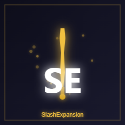

# SlashExpansion

**12 new Special Attacks and 12 new Special Effects for SlashBlade: Resharped**

[](https://www.minecraft.net/)
[](https://files.minecraftforge.net/)
[](https://www.curseforge.com/minecraft/mc-mods/slashblade-resharped)
[](LICENSE)

[中文](README.md) | [**English**](README_EN.md)

</div>

---

## What is this

> This page targets **Minecraft 1.20.1 / Forge**. The 1.21.1 / NeoForge build is a separate build (NeoForge branch) with identical content.

**SlashExpansion** is an addon for [SlashBlade: Resharped](https://www.curseforge.com/minecraft/mc-mods/slashblade-resharped). It adds **12 brand-new Special Attacks (SA)** and **12 powerful Special Effects (SE)**.

- **No new swords** — it only expands the skill and trait system of SlashBlade.
- Every SA scales off the **blade you are holding**, so damage grows with your gear instead of falling off late game.
- Each SA plays a **multi-stage timeline animation** (charge → slash → impact → aftermath) rather than a single particle burst.
- Damage numbers, chest loot for SAs, and crafting recipes for SEs are **fully configurable**, so modpacks can tune everything.

---

## Showcase

> Captured in game, no color grading applied.

### Animations

<table>
  <tr>
    <td align="center">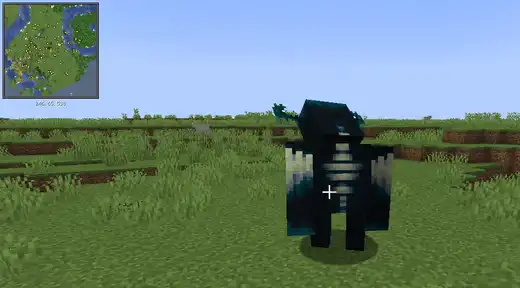<br><sub>Wan Jian Gui Zong</sub></td>
    <td align="center">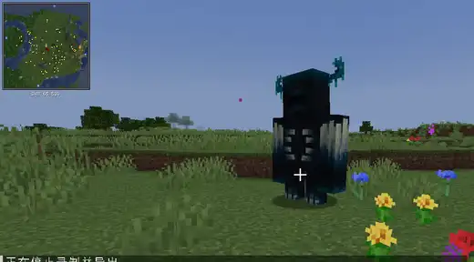<br><sub>Senbonzakura</sub></td>
  </tr>
  <tr>
    <td align="center">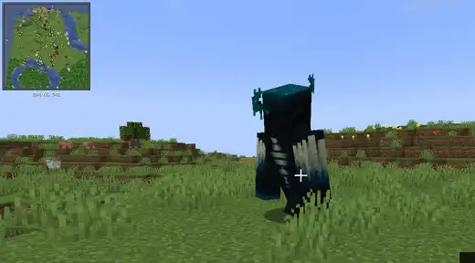<br><sub>Qi Sha Jian Jie</sub></td>
    <td align="center">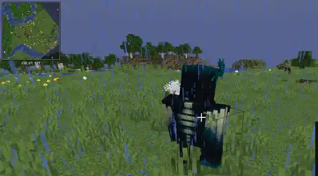<br><sub>Blood Moon Slash</sub></td>
  </tr>
  <tr>
    <td align="center">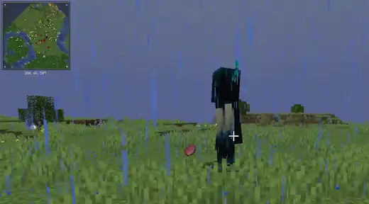<br><sub>Thor's Wrath</sub></td>
    <td align="center">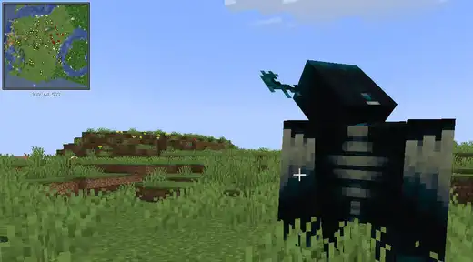<br><sub>Immovable King</sub></td>
  </tr>
</table>

### Still frames

<table>
  <tr>
    <td align="center">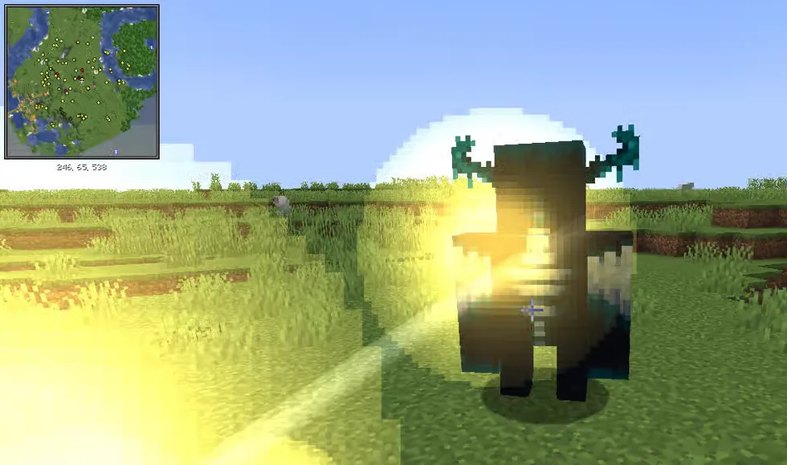<br><sub>Wan Jian Gui Zong</sub></td>
    <td align="center">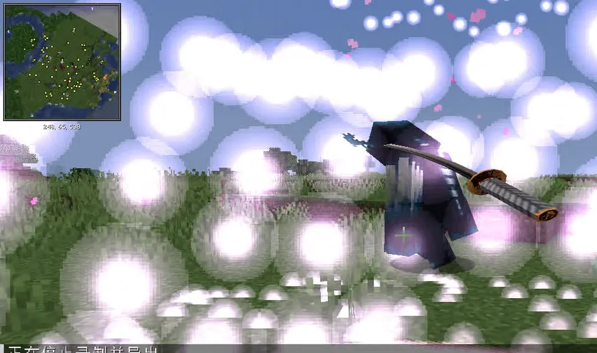<br><sub>Senbonzakura</sub></td>
  </tr>
  <tr>
    <td align="center">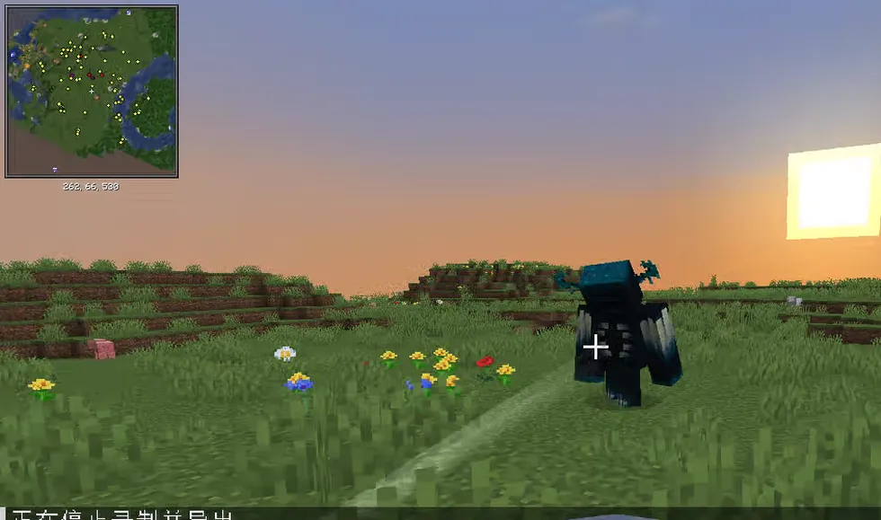<br><sub>Rift Slash</sub></td>
    <td align="center">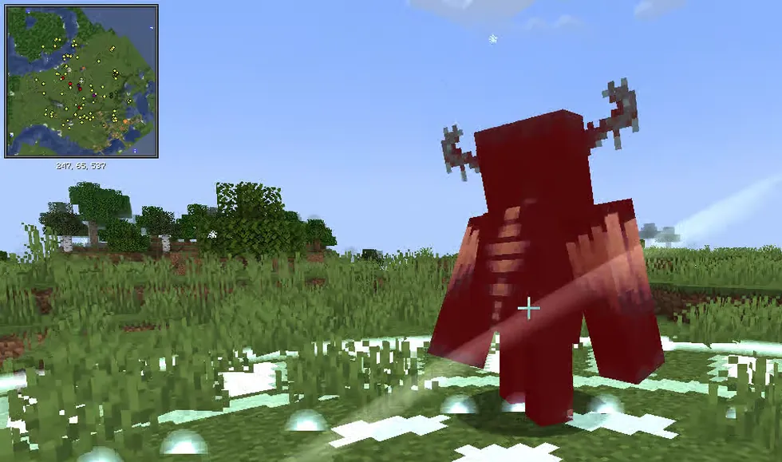<br><sub>Frost Domain</sub></td>
  </tr>
  <tr>
    <td align="center">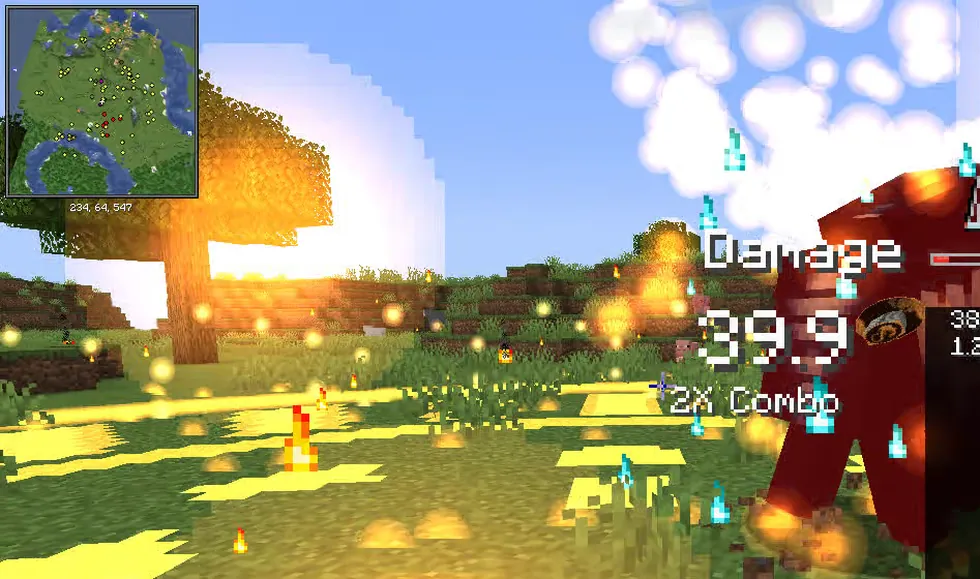<br><sub>Inferno</sub></td>
    <td align="center">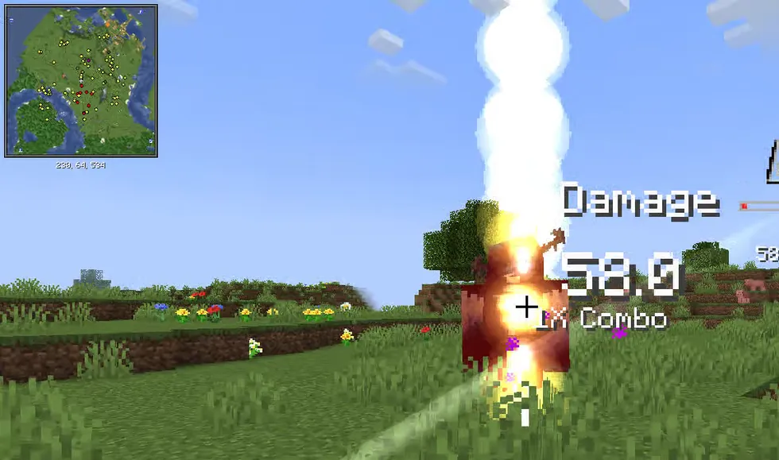<br><sub>Zhan Tian Ba Jian Shu</sub></td>
  </tr>
  <tr>
    <td align="center">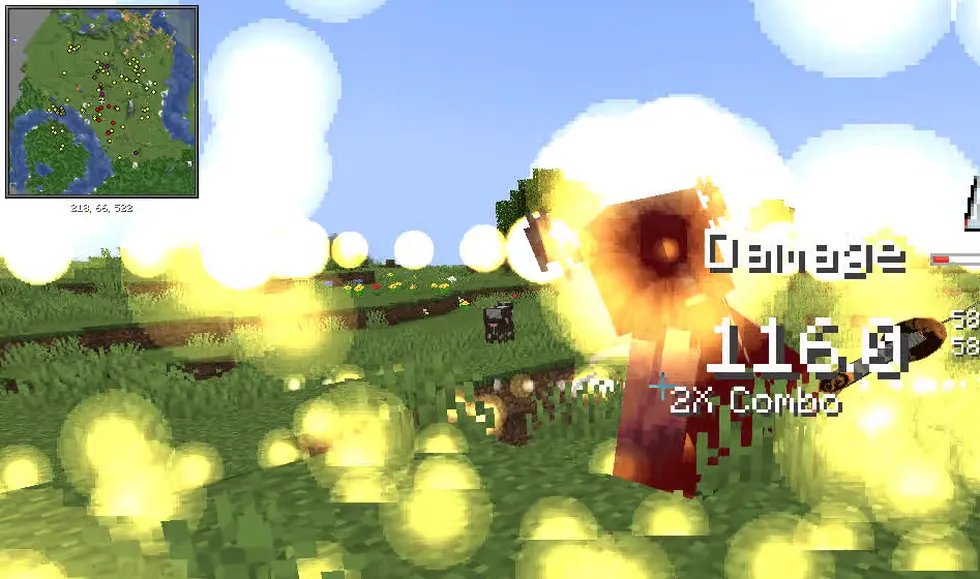<br><sub>Jian Dang Ba Huang</sub></td>
    <td align="center">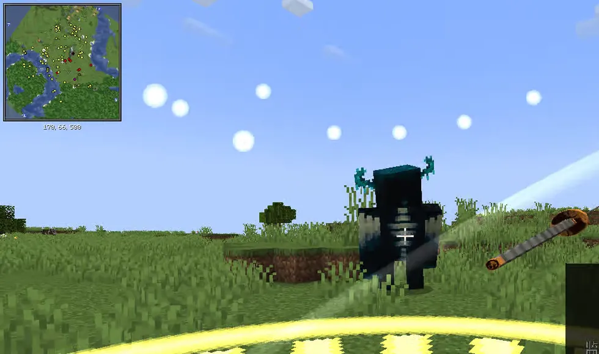<br><sub>Geng Jin Jian Jue</sub></td>
  </tr>
  <tr>
    <td align="center">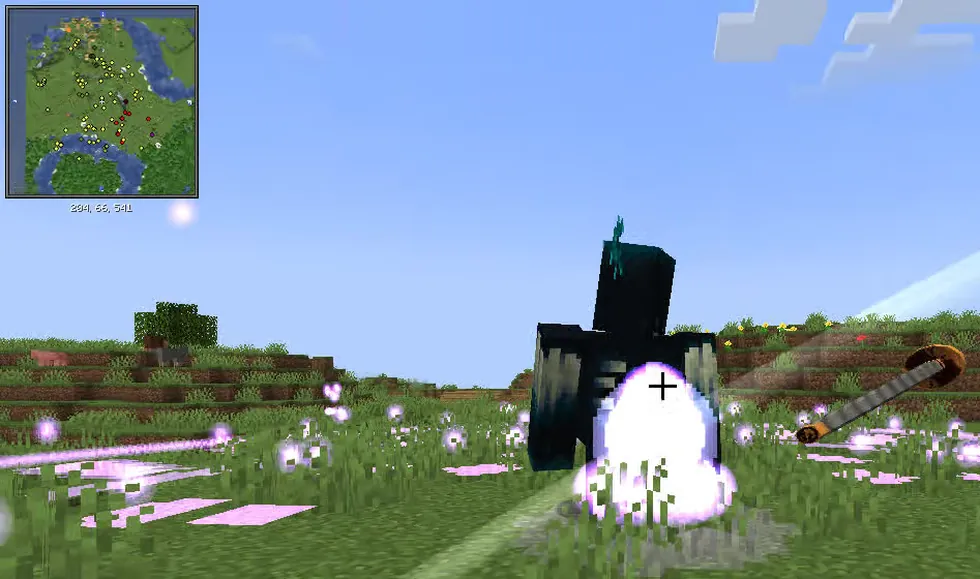<br><sub>Qi Sha Jian Jie</sub></td>
    <td align="center">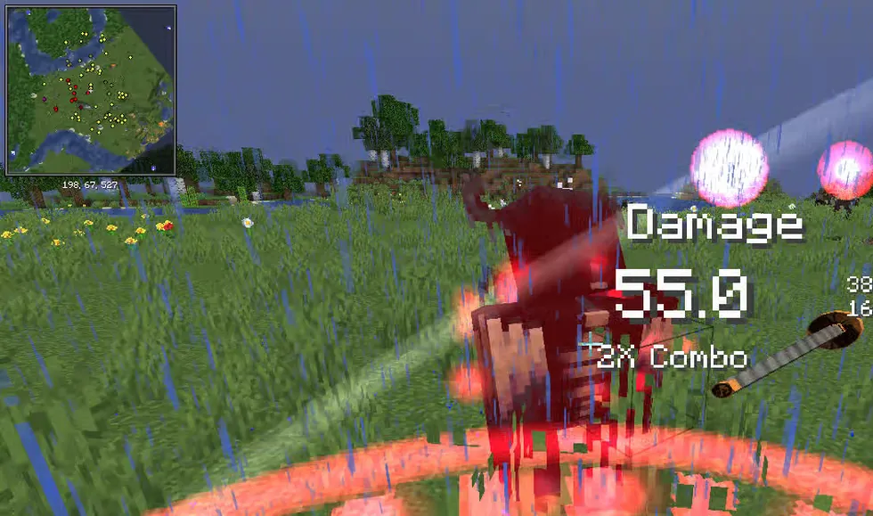<br><sub>Blood Moon Slash</sub></td>
  </tr>
  <tr>
    <td align="center">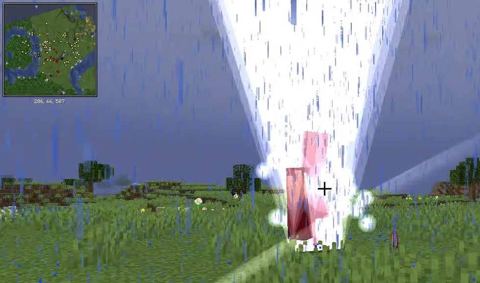<br><sub>Thor's Wrath</sub></td>
    <td align="center">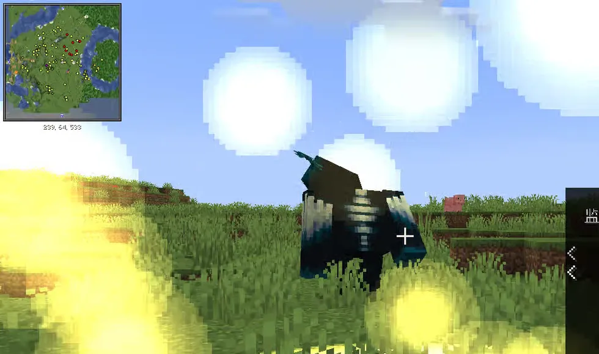<br><sub>Immovable King</sub></td>
  </tr>
</table>

---

## Download

- **GitHub Releases**: <https://github.com/lisheng233/SlashExpansion/releases>

> Pick the jar that matches your game version (the filename contains `1.20.1` or `1.21.1`).

---

## Installation
| Requirement | Version |
| :--- | :--- |
| Minecraft | **1.20.1** |
| Forge | **47.x** (built against 47.4.16) |
| [SlashBlade: Resharped](https://www.curseforge.com/minecraft/mc-mods/slashblade-resharped) | **1.5.0 or newer** |

1. Install Forge for your Minecraft version.
2. Drop **SlashBlade: Resharped** and this mod into your `mods/` folder.
3. Launch the game. Both **single player** and **dedicated servers** are supported — install it on the client *and* the server.

> A config file is generated at `config/slashexpansion-common.toml` on first launch.

---

## The 12 Special Attacks

| SA | Effect | Damage | Chest loot |
| :--- | :--- | :--- | :--- |
| **Wan Jian Gui Zong** | Summons 10–256 phantom blades from the sky; count scales with XP level | 80% | Ancient City 10%, Nether Fortress 8% |
| **Senbonzakura** | Cherry blossom blade ring, 4–6 blades per target, piercing | 120% | Ancient City 20% |
| **Rift Slash** | Dash forward + 8-direction blade wave | 180% | End Ship / End City 25% |
| **Frost Domain** | Freezes a 20-block area: Slowness X, Weakness II, Mining Fatigue IV | 80% | Ancient City 15% |
| **Inferno** | Ground flame eruption + 12s burning, +50% against Nether mobs | 100% + burn | Bastion Treasure 15% |
| **Zhan Tian Ba Jian Shu** | Huge vertical slash, travels 64 blocks, ignores obstacles | 150% | Ancient City 10%, End City 12% |
| **Jian Dang Ba Huang** | Huge horizontal slash, travels 64 blocks, ignores obstacles | 150% | Ancient City 10%, End City 12% |
| **Geng Jin Jian Jue** | 1–100 golden phantom blades, count tied to refine level, ignores armor | 160% | Ancient City 8%, Bastion Treasure 10% |
| **Qi Sha Jian Jie** | Domain hits 7 times, cycling 7 damage types; range grows with kills | 100% × 7 | Ancient City 5%, Nether Fortress 6% |
| **Blood Moon Slash** | Consumes 30% of current health to deal base damage plus health converted into damage (scales with refine, ignores armor) in an 8-block cone | Base + converted | Nether Fortress 10% |
| **Thor's Wrath** | 7 lightning bolts strike random enemies within 20 blocks, 120% damage and 3s paralysis each | 120% × 7 | Bastion Treasure 12% |
| **Immovable King** | 3s of total damage immunity while rooted, then 200% damage and knockback in a 10-block radius | 200% | Bastion Treasure 8% |

**How damage is calculated**

```
base = max(10.0, blade attack + refine × 0.5 + Power enchant level × 2.0 + player attack)
final = base × SA multiplier
```

- The lower bound, refine bonus, Power bonus and every SA multiplier are configurable.
- **Rift Slash** resolves each of its 8 blades at 180%, so a full hit deals `8 × 180%`. Tune `[sa.rift_slash]` `damageMultiplier` or `bladeCount` to soften it.
- **Thor's Wrath** lightning is visual only by default (`[sa.thors_wrath] visualOnly = true`) — no vanilla lightning damage or fire.

---

## The 12 Special Effects

| SE | Effect |
| :--- | :--- |
| **Power of the Wind God** | Jump Boost III, fall immunity, +100% movement speed, +150% flight speed (main hand only) |
| **Frost Glow** | Immune to frost damage; attacks deal bonus frost damage |
| **Transcendent Will** | Enchantments +5, damage ×1.5, crit chance +25% |
| **Abyss Whisper** | Level ≤99: self Nausea I, Hunger I, Bad Luck V, Wither II; attacks apply Wither X, Blindness I, Weakness V, Slowness V, Mining Fatigue III. Level ≥100: self Bad Luck III, Wither I |
| **Void Power** | Attacks deal void damage and debuff the target; immune to void damage and debuffs while held |
| **Admin's Might** | **Requires permission level 4**: immune to damage, debuffs and knockback; can fly, regenerates to full and clears debuffs; melee kills instantly (3-block splash by default). Damage, removal and kicks are blocked at the lowest level |
| **Flame Heart** | Attacks ignite for 5s; immune to fire; +20% speed in the Nether |
| **Void Walker** | Hovers when walking off edges; +30% speed in the End; ×2 damage to Endermen |
| **Tempered Soul** | Durability cost halved; +1 durability per kill; every 10 kills consume 100 proud souls for +1 refine (up to 100 times) |
| **Grim Reaper's Pact** | Below 30% health: +50% attack, at the cost of 1 HP per second (never lethal) |
| **Elven Blessing** | +20% speed by day, +30% attack by night; immune to poison; +50% arrow damage |
| **Dragon Soul Resonance** | Permanent +10% attack after slaying the Ender Dragon; 5% chance on hit to unleash dragon breath |

---

## Getting and using them

### SAs come from structure chests

Chests can contain a **proud soul sphere carrying the corresponding SA**:

| Structure | Available SA | Chance |
| :--- | :--- | :--- |
| Ancient City | Wan Jian Gui Zong / Senbonzakura / Frost Domain / Zhan Tian Ba Jian Shu / Jian Dang Ba Huang / Geng Jin Jian Jue / Qi Sha Jian Jie | 10% / 20% / 15% / 10% / 10% / 8% / 5% |
| End Ship · End City | Rift Slash / Zhan Tian Ba Jian Shu / Jian Dang Ba Huang | 25% / 12% / 12% |
| Bastion (treasure) | Inferno / Geng Jin Jian Jue / Thor's Wrath / Immovable King | 15% / 10% / 12% / 8% |
| Nether Fortress | Wan Jian Gui Zong / Qi Sha Jian Jie / Blood Moon Slash | 8% / 6% / 10% |

### SEs are crafted

All 12 SEs are crafted; check JEI or the recipe book. Recipes are fully configurable.

> **Dragon Soul Resonance** has only 9 crafting slots, so it uses 1 Dragon Egg + 7 Dragon's Breath + 1 proud soul crystal.

### Applying to a blade

1. Get a **proud soul sphere** carrying an SA, or a **proud soul crystal** carrying an SE.
2. Place it on a **blade stand** together with any SlashBlade.
3. Left-click — the SA or SE is transferred onto the blade.
4. SAs are cast by **charging with right-click**; SEs are **passive** while the blade is held.

---

## Configuration

Everything lives in **`config/slashexpansion-common.toml`** (generated on first launch).

- Numeric options: restart the game to apply.
- `[loot]` and `[recipe]`: restart the server or run `/reload`.
- `[vfx]`: **hot-reloaded**, changes apply immediately.

| Section | Contents |
| :--- | :--- |
| `[damage]` | Base damage formula: lower bound, refine bonus, Power bonus |
| `[sa.<skill>]` | Per-SA multiplier, search radius, blade count, effect radius, duration and levels |
| `[entities.giant_slash]` | Travel distance, speed and hit detection of the giant slashes |
| `[se.<effect>]` | Per-SE multipliers, levels and check intervals |
| `[loot]` | Where SAs appear in structure chests |
| `[recipe]` | SE crafting recipes |
| `[vfx]` | Global toggle, particle scale, concurrent limit, screen flash and camera shake |

### Chest loot (`[loot]`)

```toml
[loot]
enabled = true
item = "slashblade:proudsoul_sphere"   # what drops
# Format: "loot_table_id|SA id|chance (0~1)"
entries = [
  "minecraft:chests/ancient_city|slashexpansion:wan_jian_gui_zong|0.10",
  "minecraft:chests/end_city_treasure|slashexpansion:rift_slash|0.25"
]
```

Add or remove entries, change structures and chances, or put the same SA in several structures.

### SE crafting (`[recipe]`)

```toml
[recipe]
overrideJsonRecipes = true      # true = generate all 12 recipes from this config

[recipe.frost_glow]             # one section per SE
enabled = true                  # false removes the recipe
shapeless = false               # true = shapeless using `ingredients`
resultItem = "slashblade:proudsoul_crystal"
pattern = ["CIC", "BWP", "CAC"] # 1–3 rows, 1–3 chars each, space = empty
keys = ["C=slashblade:proudsoul_crystal", "I=minecraft:blue_ice"]
ingredients = []                # used when shapeless = true
```

The result automatically carries the matching `SpecialEffectType`.

### Visual effects (`[vfx]`)

```toml
[vfx]
enabled = true                # master switch; damage is unaffected when disabled
particleScale = 1.0           # particle multiplier (0.0 ~ 3.0) — lower it if you drop frames
maxConcurrentEffects = 96     # how many effects may play at once
particleBudgetPerTick = 320   # hard cap on particles emitted per tick
screenEffects = true          # hit flash / vignette
screenShake = true            # camera shake
screenEffectScale = 1.0       # screen effect strength
```

---

## Commands

```
/slashexpansion vfx <name>     # play the full animation of an SA
/slashexpansion vfx list       # list every available name
```

Requires **permission level 2** and runs on the server. Handy for tuning, recording, or just watching.

Names: `wan_jian_gui_zong`, `senbonzakura`, `rift_slash`, `frost_domain`, `inferno`, `zhan_tian_ba_jian_shu`, `jian_dang_ba_huang`, `geng_jin_jian_jue`, `qi_sha_jian_jie`, `blood_moon_slash`, `thors_wrath`, `immovable_king_cast`, `immovable_king_release`.

### Quick testing

```mcfunction
# a blade with an SA
/give @p slashblade:slashblade{SpecialAttackType:"slashexpansion:wan_jian_gui_zong"}

# a proud soul crystal with an SE
/give @p slashblade:proudsoul_crystal{SpecialEffectType:"slashexpansion:wind_god_power"}
```

Swap the ID for any SA / SE listed above.


## Compatibility & notes

- **Install on both client and server.** A client-only install cannot join a server running this mod.
- Mods that heavily rewrite damage, entity removal or loot may interact with it; everything here uses standard damage sources, so coexistence is normally fine.
- **Admin's Might** directly rewrites player abilities and blocks damage / removal / kicks at a low level. It is intentionally invasive and best used in creative-oriented packs.
- Disabling `[vfx]` never changes damage or hit detection — only the visuals.

---

## Feedback

Bugs, suggestions, or mod compatibility conflicts? Please open an [issue on GitHub](https://github.com/lisheng233/SlashExpansion/issues).

Please include:

- Minecraft version, loader version, SlashBlade version
- This mod's version (the one in the jar filename)
- `logs/latest.log` or the crash report from `crash-reports/`
- Steps to reproduce (which SA / SE, and whether other mods are involved)

---

## Languages
Simplified Chinese and English are bundled (`zh_cn` / `en_us`).

---

## Credits & license

- Thanks to the author of [SlashBlade: Resharped](https://www.curseforge.com/minecraft/mc-mods/slashblade-resharped) — none of this would exist without it.
- Licensed under **GPL-3.0**, see [LICENSE](LICENSE).

<details>
<summary>Building from source (developers)</summary>

Requires JDK 17 and the bundled Gradle wrapper:

```bash
gradlew build
```

Output: `build/libs/slashexpansion-1.20.1-2.0.jar`.

</details>